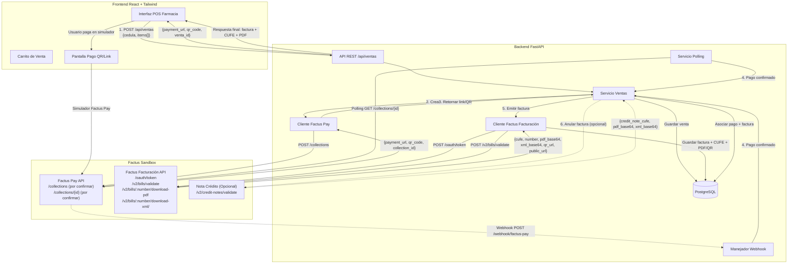
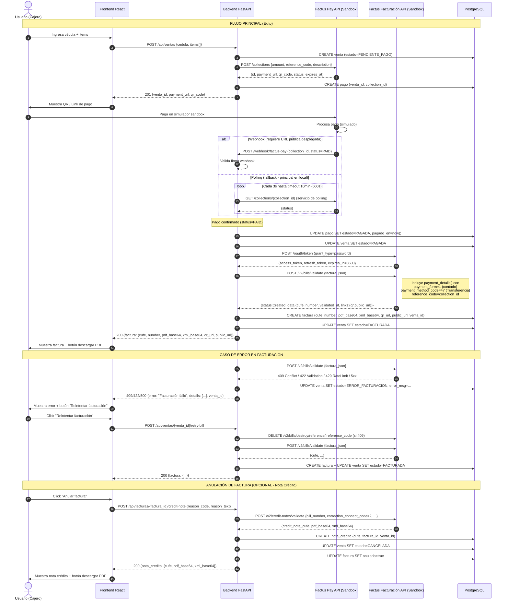
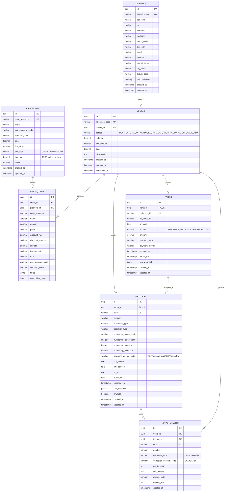

# Arquitectura del POS Farmacia - Integración Factus Pay + Facturación

## 1. Diagrama de Arquitectura (Flowchart)



---

## 2. Diagrama de Secuencia (Opción A: Cobro Previo)



---

## 3. Diagrama Entidad-Relación (Mermaid)



---

## 4. Tabla de Endpoints Propuestos

### Backend (FastAPI)

| Método | Endpoint | Descripción | Request Body | Response |
|--------|----------|-------------|--------------|----------|
| `POST` | `/api/ventas` | Crea venta, genera cobro en Factus Pay, retorna QR/link | `{cedula, items[], observacion?}` | `{venta_id, payment_url, qr_code, expires_at}` |
| `GET` | `/api/ventas/{venta_id}` | Consulta estado de venta y factura asociada | - | `{venta, pago, factura?}` |
| `POST` | `/api/ventas/{venta_id}/retry-bill` | Reintenta emisión de factura tras error (elimina pendiente si 409) | - | `{factura: {cufe, pdf_base64, xml_base64, ...}}` |
| `GET` | `/api/facturas/{factura_id}/pdf` | Proxy descarga PDF desde Factus (decodifica base64) | - | `application/pdf` (stream) |
| `GET` | `/api/facturas/{factura_id}/xml` | Proxy descarga XML desde Factus (decodifica base64) | - | `application/xml` (stream) |
| `POST` | `/webhook/factus-pay` | Recibe notificación de pago confirmado (Factus Pay) - **SOLO funciona con app desplegada (URL pública)** | `{collection_id, status, ...}` | `200 OK` |
| `GET` | `/api/clientes/{identificacion}` | Busca/crea cliente por cédula | - | `{cliente}` |
| `GET` | `/api/productos` | Lista productos activos (con paginación) | `?page=&limit=&search=` | `{items[], total}` |
| `POST` | `/api/facturas/{factura_id}/credit-note` | **(Opcional)** Anula factura emitiendo nota crédito | `{reason_code, reason_text}` | `{nota_credito: {cufe, pdf_base64, xml_base64}}` |

### Factus Pay API (Sandbox) - **POR CONFIRMAR (documentación de Factus Pay pendiente)**

| Método | Endpoint | Descripción |
|--------|----------|-------------|
| `POST` | `/collections` | Crear link/QR de cobro |
| `GET` | `/collections/{id}` | Consultar estado de cobro (polling) |
| `POST` | `/webhooks` | Registrar URL de webhook (configuración) |

**Payload crear cobro (POR CONFIRMAR):**
```json
{
  "amount": 133300,
  "reference_code": "VTA-2026-0001",
  "description": "Venta farmacia - 3 items",
  "currency": "COP",
  "expiration_minutes": 30,
  "redirect_url": "https://mi-pos.com/pago/exitoso"
}
```

**Respuesta (POR CONFIRMAR):**
```json
{
  "id": "col_abc123",
  "payment_url": "https://pay-sandbox.factus.com.co/p/col_abc123",
  "qr_code": "data:image/png;base64,...",
  "status": "PENDING",
  "expires_at": "2026-01-15T10:30:00Z"
}
```

### Factus Facturación API (Sandbox) - **Endpoints oficiales v2**

| Método | Endpoint | Descripción |
|--------|----------|-------------|
| `POST` | `/oauth/token` | Obtener access_token (OAuth2 password grant) |
| `POST` | `/oauth/token` | Renovar access_token (grant_type=refresh_token) |
| `POST` | `/v2/bills/validate` | Crear y validar factura electrónica ante DIAN |
| `GET` | `/v2/bills/:number/download-pdf` | Descargar PDF (retorna base64 en `pdf_base_64_encoded`) |
| `GET` | `/v2/bills/:number/download-xml/` | Descargar XML (retorna base64 en `xml_base_64_encoded`) |
| `GET` | `/v2/bills/:number` | Consultar factura por número |
| `GET` | `/v2/bills/:number/events` | Eventos DIAN (aceptación tácita, etc.) |
| `DELETE` | `/v2/bills/destroy/reference/:reference_code` | Eliminar factura no validada (para reintentar tras 409) |
| `POST` | `/v2/credit-notes/validate` | **(Opcional)** Crear y validar nota crédito |

**Headers obligatorios:**
```
Content-Type: application/json
Authorization: Bearer <access_token>
Accept: application/json
```

**Autenticación OAuth2:**
- **Tipo:** Password grant (v2 usa `grant_type=password` con `client_id`, `client_secret`, `username`, `password`)
- **Token expira en:** 3600 segundos (1 hora)
- **Refresh token:** Mismo endpoint `/oauth/token` con `grant_type=refresh_token`
- **Base URL Sandbox:** `https://api-sandbox.factus.com.co`
- **Base URL Producción:** `https://api.factus.com.co`

**Medio de pago en factura (payment_details):**
- `payment_form`: `1` = Pago de contado
- `payment_method_code`: `47` = Transferencia (PSE/Factus Pay) — **código DIAN oficial**
- `reference_code`: `collection_id` de Factus Pay
- `amount`: monto total de la venta

**Límite de solicitudes (Rate Limit):**
- **80 requests/minuto por usuario**
- Headers de respuesta: `X-RateLimit-Limit`, `X-RateLimit-Remaining`, `X-RateLimit-Reset`, `Retry-After` (solo al exceder)
- HTTP 429 si se excede el límite

**Códigos de error HTTP:**
| Código | Descripción |
|--------|-------------|
| 200 | Solicitud exitosa |
| 201 | Recurso creado exitosamente |
| 204 | Sin contenido |
| 400 | Solicitud mal formada |
| 401 | No autorizado / No autenticado |
| 402 | Pago requerido |
| 403 | Acceso denegado |
| 404 | Ruta o recurso no encontrado |
| 409 | Conflicto (factura pendiente) → DELETE y reintentar |
| 422 | Errores de validación |
| 429 | Demasiadas solicitudes (rate limit) |
| 500 | Error interno del servidor |
| 503 | Servicio no disponible / En mantenimiento |

> **Nota importante sobre webhook vs polling:** El webhook de Factus Pay **solo funciona cuando la aplicación está desplegada con una URL pública accesible desde internet** (requiere HTTPS y dominio válido). En entorno local (localhost), el método principal para confirmar el pago es el **polling** (consulta periódica a `GET /collections/{id}` cada 3 segundos con timeout de **10 minutos / 600 segundos**). La flecha de polling en el diagrama va del **PollingSvc (Backend) hacia Factus Pay API**.

---

## 5. Explicación de Componentes

### Frontend (React + Tailwind)
- **Pantalla POS**: Búsqueda de productos, carrito, ingreso de cédula cliente.
- **Pantalla Pago**: Muestra QR code (imagen base64) y botón "Abrir link de pago" que redirige a `payment_url` de Factus Pay en nueva pestaña.
- **Pantalla Resultado**: Tras webhook/polling, muestra factura emitida con CUFE, número, botones "Descargar PDF" y "Ver en portal DIAN".
- **Manejo de errores**: Si facturación falla, botón "Reintentar facturación" llama a `/retry-bill` (elimina pendiente si 409 y reintenta).
- **(Opcional) Anulación**: Botón "Anular factura" llama a `/api/facturas/{factura_id}/credit-note` con `reason_code=2` (Anulación) y muestra nota crédito con CUFE y PDF.

### Backend (FastAPI)
- **`/api/ventas` (POST)**: Orquesta el flujo completo:
  1. Valida cédula (busca/crea cliente en BD).
  2. Calcula totales (subtotal, IVA 19% solo en productos no excluidos, total).
  3. Crea `VENTA` en BD con `estado=PENDIENTE_PAGO`.
  4. Llama a Factus Pay `/collections` con `amount=total`, `reference_code=venta.reference_code`.
  5. Crea registro en `PAGOS` con `venta_id` y `collection_id` (varchar).
  6. Retorna `payment_url` + `qr_code` al frontend.
- **Webhook `/webhook/factus-pay`**: **SOLO funciona con app desplegada (URL pública HTTPS)**. Valida firma HMAC, actualiza `PAGOS.estado=PAGADA`, dispara emisión de factura en background task.
- **Polling (fallback - principal en local)**: Job periódico cada 3s consulta `/collections/{id}` hasta `PAGADA` o timeout **10 minutos (600s)**. La flecha va del **PollingSvc hacia Factus Pay API**.
- **Emisión factura**: Construye JSON según spec Factus v2:
  - `operation_type=10` (Estándar)
  - `payment_details[]` con `payment_form=1` (contado), `payment_method_code=47` (Transferencia), `reference_code=collection_id`, `amount=total`
  - `items[].price` = precio neto (sin impuestos)
  - `items[].taxes[]` = `[{"code": "01", "rate": "19.00"}]` para productos con IVA, o `[{"is_excluded": true}]` para productos excluidos (la mayoría de medicamentos)
  - Llama `POST /v2/bills/validate`, guarda CUFE, PDF base64, XML base64, QR, public_url en `FACTURAS`, actualiza `VENTA.estado=FACTURADA`.
- **Manejo errores Factus v2**:
  - 409 Conflict → `DELETE /v2/bills/destroy/reference/:reference_code` y reintentar `POST /v2/bills/validate`
  - 422 Validation → Loggear detalles, mostrar al usuario
  - 429 RateLimit → Backoff exponencial respetando `Retry-After`
  - 5xx → Reintento con backoff exponencial
- **(Opcional) Nota crédito**: `POST /api/facturas/{factura_id}/credit-note` → llama `POST /v2/credit-notes/validate` con `correction_concept_code=2` (Anulación), `bill_number`, crea `NOTAS_CREDITO`, actualiza `VENTA.estado=CANCELADA` y `FACTURAS.anulada=true`.

### Base de Datos (PostgreSQL 17 en Docker Compose)
- **Servicio `db`**: PostgreSQL 17 (`postgres:17`, imagen ya descargada) con volumen persistente `pgdata:/var/lib/postgresql/data` en `docker-compose.yml`.
- **ORM**: SQLAlchemy 2.0 (Declarative API, `Mapped`, `mapped_column`, `relationship`).
- **Migraciones**: Alembic (entorno `alembic/env.py` configurado con `target_metadata` de `Base.metadata`).
- **Tablas normalizadas** con FKs, constraints y `UUID` como PK (`gen_random_uuid()`, incluido en PostgreSQL sin extensiones).
- `VENTAS` es la entidad central que liga cliente e items; `PAGOS` y `FACTURAS` se asocian a ella mediante `venta_id`.
- `PAGOS` almacena trazabilidad completa del cobro (webhook raw, estados); `collection_id` es `varchar`.
- `FACTURAS` guarda respuesta completa de Factus para auditoría y reimpresión; `payment_method_code = '47=Transferencia (PSE/Factus Pay)'`; PDF y XML en base64.
- Relación `PAGOS` - `FACTURAS` es **uno a uno opcional** (mismo `venta_id`).
- `NOTAS_CREDITO` (opcional) para trazabilidad de anulaciones; `correction_concept_code=2`.
- **Seed script** (`scripts/seed.py`): ~15 medicamentos con:
  - `unit_measure_code = '94'` (Unidad — tabla DIAN)
  - `standard_code = '999'` (Estándar adopción contribuyente)
  - Mezcla realista de impuestos:
    - Medicamentos (ej. acetaminofén, ibuprofeno, amoxicilina, loratadina): `iva_excluido = true`, sin `tax_code` ni `tax_rate` (en la factura: `taxes: [{"is_excluded": true}]`)
    - Cuidado personal (ej. protector solar, crema hidratante, cepillo dental): `iva_excluido = false`, `tax_code = '01'`, `tax_rate = 19.00`
  - Precios netos (sin IVA) típicos de farmacia (ej. 10000.00, 25000.00, 50000.00)

### Factus Pay (Sandbox)
- Genera link de pago y QR code para el monto exacto de la venta.
- Simulador permite probar pagos aprobados/rechazados sin dinero real.
- Notifica via webhook (configurado en dashboard Factus, **requiere URL pública**) o se consulta por polling.
- **Documentación pendiente**: endpoints, payloads, headers marcados como "POR CONFIRMAR (documentación de Factus Pay pendiente)".

### Factus Facturación (Sandbox)
- Valida y envía factura a DIAN (endpoint `POST /v2/bills/validate`).
- Retorna CUFE, número, `validated_at`, `links.qr` (portal DIAN), `links.public_url` (portal Factus), PDF y XML en base64 (endpoints `GET /v2/bills/:number/download-pdf` y `download-xml`).
- Envía correo automático al cliente (configurable `send_email=true`, solo en producción).
- **Nota crédito**: `POST /v2/credit-notes/validate` con `correction_concept_code=2` (Anulación) y `bill_number`.
- **Rate limit**: 80 req/min por usuario (headers `X-RateLimit-*`).
- **Errores**: 409 si hay factura pendiente (eliminar y reintentar), 422 validación, 429 rate limit, 5xx servidor.

---

## 6. Variables de Entorno (.env.example)

```bash
# App
APP_ENV=development

# Database
DATABASE_URL=postgresql://postgres:postgres@db:5432/farmacia_pos

# Factus Facturación (Sandbox)
FACTUS_BILL_BASE_URL=https://api-sandbox.factus.com.co
FACTUS_BILL_CLIENT_ID=your_client_id
FACTUS_BILL_CLIENT_SECRET=your_client_secret
FACTUS_BILL_USERNAME=your_username
FACTUS_BILL_PASSWORD=your_password
FACTUS_NUMBERING_RANGE_ID=123

# Factus Pay (Sandbox) - POR CONFIRMAR (documentación de Factus Pay pendiente)
FACTUS_PAY_BASE_URL=https://api-sandbox.factus.com.co
FACTUS_PAY_CLIENT_ID=your_pay_client_id
FACTUS_PAY_CLIENT_SECRET=your_pay_client_secret
FACTUS_PAY_WEBHOOK_SECRET=webhook_signing_secret

# Frontend
VITE_API_URL=http://localhost:8000
```

---

## 7. Consideraciones de Seguridad y Buenas Prácticas

1. **Tokens OAuth2 (Factus Facturación v2)**: 
   - Cachear `access_token` (expira en 3600s / 1 hora) y renovar con `refresh_token` ANTES de expirar.
   - Usar mismo endpoint `/oauth/token` con `grant_type=refresh_token` + `client_id`, `client_secret`, `refresh_token`.
   - No almacenar credenciales en código; solo en variables de entorno.

2. **Webhook HMAC (Factus Pay)**: Verificar firma `X-Factus-Signature` en header contra `FACTUS_PAY_WEBHOOK_SECRET`. **SOLO funciona con URL pública HTTPS desplegada**.

3. **Idempotencia**: Usar `reference_code` único por venta (`venta.reference_code`) para evitar facturas duplicadas. Factus rechaza con 409 Conflict si ya existe.

4. **Manejo errores Factus Facturación v2**:
   - **409 Conflict** → Factura pendiente por enviar a DIAN. Eliminar con `DELETE /v2/bills/destroy/reference/:reference_code` y reintentar `POST /v2/bills/validate`.
   - **422 Validation** → Loggear detalles completos (`errors` en respuesta), mostrar al usuario para corrección de datos.
   - **429 Too Many Requests** → Rate limit excedido (80 req/min). Respetar header `Retry-After` y hacer backoff exponencial.
   - **5xx Server Error** → Reintento con backoff exponencial; no eliminar la factura, la DIAN puede estar procesando.

5. **Concurrencia**: Lock optimista en `VENTA` al emitir factura (evitar doble emisión simultánea).

6. **Logs**: Registrar request/response completos a Factus (sin secrets) para auditoría y soporte.

7. **HTTPS obligatorio** en producción para webhooks, callbacks y endpoints de Factus.

8. **Rate limiting**: Implementar cliente HTTP con retry automático y respeto a headers `X-RateLimit-Remaining`, `X-RateLimit-Reset`, `Retry-After`.

9. **Reintentos DIAN**: Si la DIAN tarda en responder, la factura queda con `is_validated=false` sin errores de rechazo. NO eliminar; reintentar `POST /v2/bills/validate` con los mismos datos — Factus detecta reintento y consulta estado en DIAN.

---

## 8. Fuentes

Documentación oficial de **Factus Facturación API v2** consultada en https://developers.factus.com.co/:

- **Autenticación (Password Grant):** https://developers.factus.com.co/autenticacion/auth/
- **Refresh Token:** https://developers.factus.com.co/autenticacion/refresh-token/
- **Crear y validar factura:** https://developers.factus.com.co/facturas/crear-y-validar/
- **Campos de la factura:** https://developers.factus.com.co/facturas/descripcion-de-campos/
- **Descargar PDF:** https://developers.factus.com.co/facturas/descargar-pdf/
- **Descargar XML:** https://developers.factus.com.co/facturas/descargar-xml/
- **Eliminar factura pendiente (409):** https://developers.factus.com.co/facturas/eliminar/
- **Ejemplo con impuesto excluido:** https://developers.factus.com.co/facturas/ejemplos/estandar-impuesto-excluido/
- **Crear y validar nota crédito:** https://developers.factus.com.co/notas-credito/crear-y-validar/
- **Manejo de errores:** https://developers.factus.com.co/manejo-errores
- **Respuestas del API (códigos HTTP):** https://developers.factus.com.co/respuestas-del-api
- **Límite de request (Rate Limiting):** https://developers.factus.com.co/limite-de-request
- **Tablas de referencia (códigos DIAN):** https://developers.factus.com.co/tablas-de-referencia/tablas/
  - Métodos de pago: código `47` = Transferencia (PSE/Factus Pay)
  - Formas de pago: código `1` = Pago de contado
  - Tipos de operación: código `10` = Estándar
  - Tipos de documento: código `01` = Factura electrónica de venta
  - Conceptos de corrección: código `2` = Anulación de factura electrónica
- **Cambios de V1 a V2:** https://developers.factus.com.co/buenas-practicas/cambios-v2-v1/

> **Nota:** Este sitio **NO documenta Factus Pay**. Los endpoints, payloads y headers de Factus Pay permanecen marcados como **"POR CONFIRMAR (documentación de Factus Pay pendiente)"**.